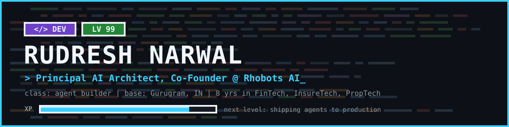

  

### 🎮 Player card

| | |
|---|---|
| **Class** | Principal AI Architect, building agents that ship to production |
| **Guild** | Co-Founder @ [Rhobots AI](https://github.com/rhobots-ai), enterprise AI delivery |
| **Level** | 8 years across FinTech, InsureTech and PropTech (ex ProgCap, Toffee Insurance, Housr) |
| **Base** | Gurugram, India |

### ⚔️ Active quests

| Quest | What it is | Role |
|---|---|---|
| [**Zwiim**](https://github.com/zwiim/zwiim) | Mac app for running coding agents | Contributor: on-device voice dictation ([#39](https://github.com/zwiim/zwiim/pull/39)) |
| [**TableIQ**](https://github.com/Table-IQ) | Free, open-source database client for Mac, optional AI with your own key ([site](https://tableiq.ideolyst.com/)) | Builder |
| [**Relay**](https://github.com/Ideolyst/relay) | Recorder app by Ideolyst ([relay.ideolyst.com](https://relay.ideolyst.com)) | Builder |
| [**Provenship**](https://github.com/RudreshNarwal/provenship) | Hand Claude Code one requirement, get back a PR with proof | Creator |

### 🌳 Skill tree

**Agents & AI:** LLM agents, RAG, document AI, self-hosted open models
**Backend:** Python, Django, Node.js, TypeScript, Rust
**Infra:** AWS, Docker, Kubernetes, microservices

  
  
  
  
  
  
  
  

### 📡 Open a channel

`> press START to collaborate_`
